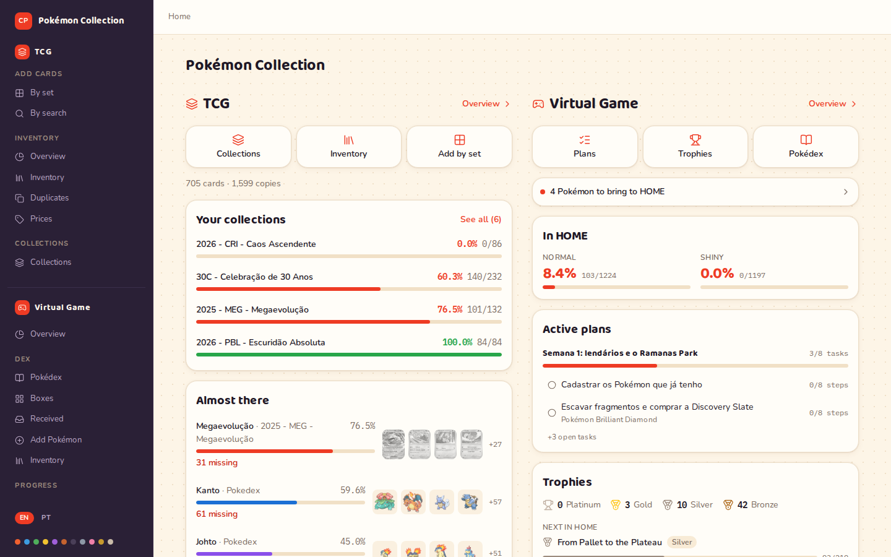
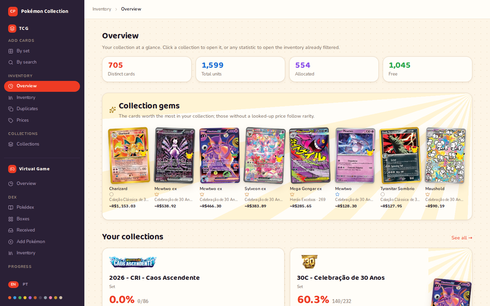
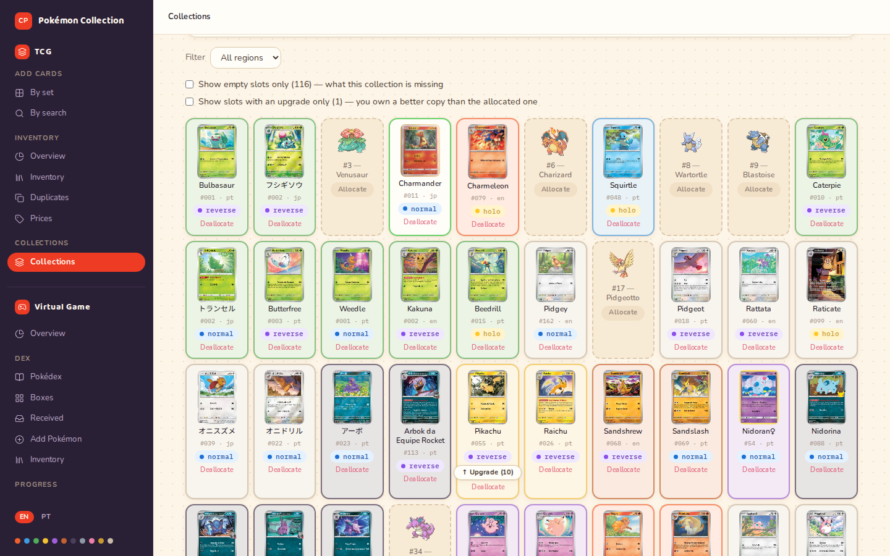
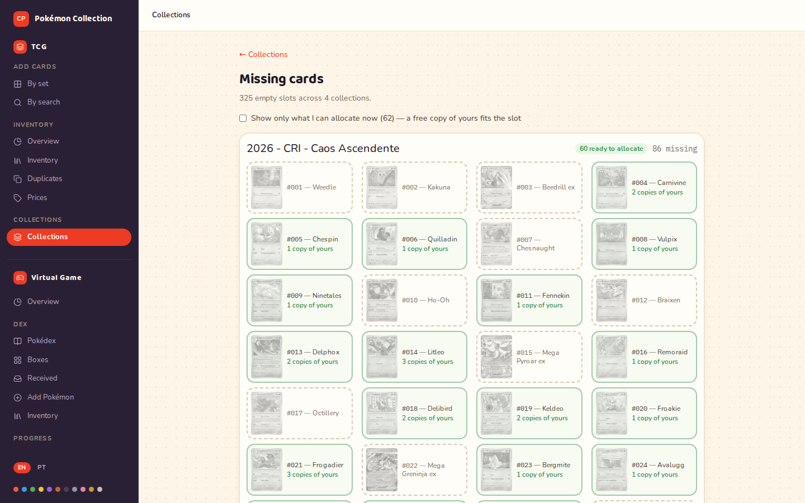
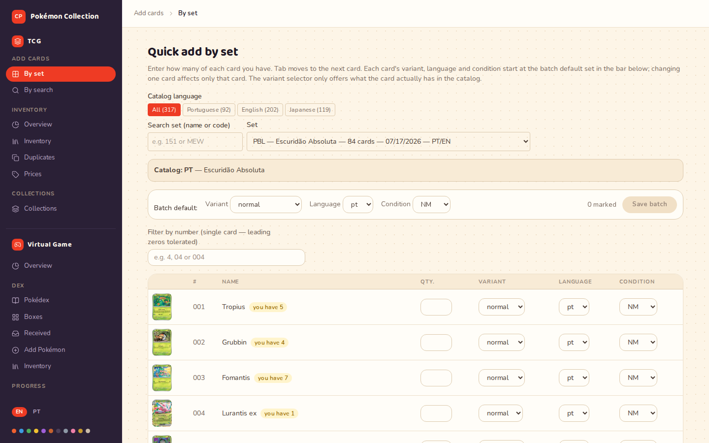
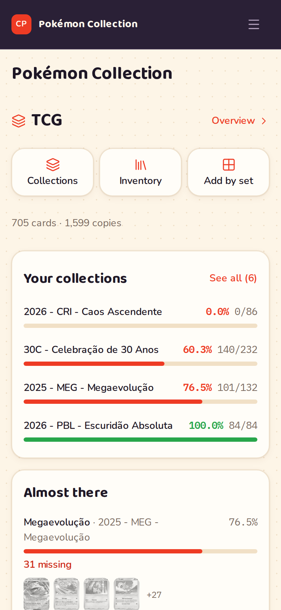
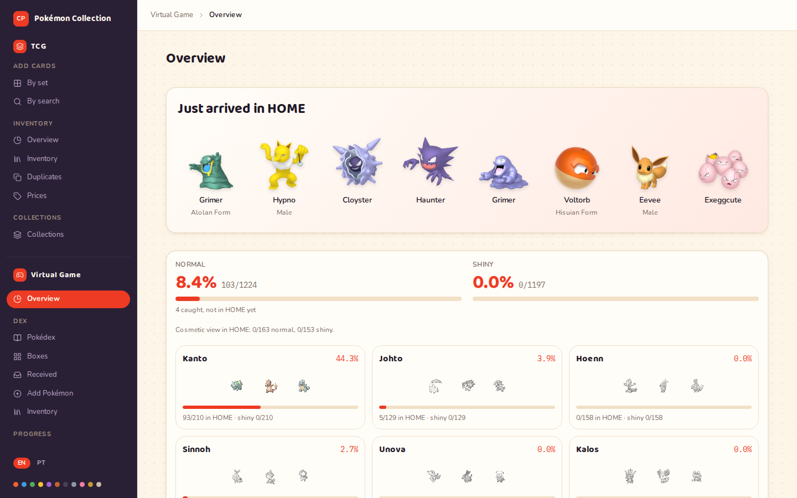
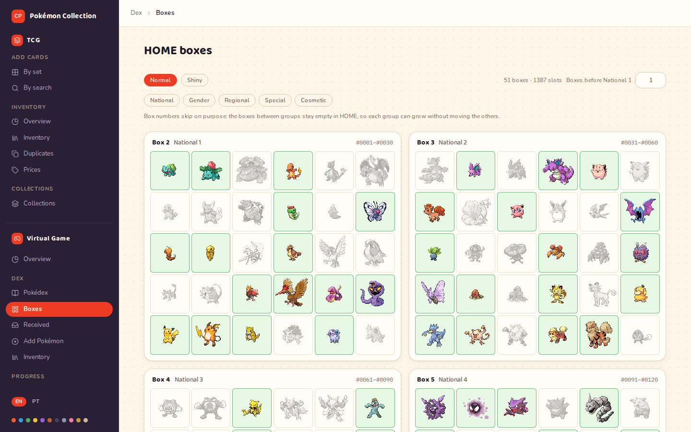

# Pokémon Collection

A catalog of your **physical** Pokémon card collection, running on your own machine. You start two
containers, open the browser and begin typing in what is in the box. The catalog comes with it,
48,372 card records in Portuguese, English and Japanese, and loads by itself on the first boot.

The question it exists to answer is **"what is missing"**: which species your Pokédex still lacks,
which numbers of a set you have not found, which empty slot a card you already own could fill.
An optional second module, the **Living Dex**, asks the same question of your Pokémon HOME boxes.



A collection is a grid of slots. A filled slot carries the copy allocated to it, with the language
and variant of the card you physically own. An empty one names the species or the card you are
still missing.

---

## Disclaimer

**This is a fan project, with no connection to Nintendo, Creatures Inc., GAME FREAK inc. or The
Pokémon Company International.** It is not an official product, it is not endorsed by any of them,
and it has no relationship with LigaPokemon, TCGdex, mypcards or PokeAPI beyond reading public data
that they publish.

Pokémon, the names of the cards, the Pokémon and the expansions, the artwork and every related
trademark belong to their respective owners. **This repository ships no card art for the program to
use**: images are loaded at display time, straight from the source, by the installation that
uses them (see [Card images](#card-images)). The card art you can see here is inside the
screenshots, which are pictures of the interface.

It is a personal, non-commercial tool for organizing a collection that already exists on paper.
Nothing here is meant for selling, professional grading or reproducing a card.

---

## What it is, and who it is for

It is a **single-user system with no accounts**, built for people who have Pokémon cards at home,
kept in a binder or a box, and want to know what they have and what they are missing. It runs on
your local network, and you can reach it from your phone away from home through a tunnel with the
optional password turned on (see [below](#optional-reaching-it-from-outside-your-network)).

It fits well if you:

- are building a **Pokédex** (one slot per species) and want the list of what has not come in yet;
- are closing out an **expansion** card by card and need to know which numbers are missing;
- have duplicates scattered around and want to set aside what can be traded;
- keep a **living dex in Pokémon HOME** and want to track it across your games;
- like having the data at home, in a Postgres that is yours, instead of in a spreadsheet or in a
  service that can shut down.

It is not meant for a public, multi-user site, or for sales and trading control.

### What it does with your cards

- **Home page** with the screens you use most and a summary of each module: how far each collection
  has come and which regions or sets are closest to complete.
- **Quick entry by set**: pick the expansion, tick the whole card grid and submit in one go. This is
  the path for typing in a large collection without giving up halfway through.
- **Entry by search** for a single card, by name, set or number.
- **Inventory** with search and filters: set, language, rarity, variant, condition, graded, location,
  allocated or free.
- **Collections** of three kinds: Pokédex, complete set or custom. Each one has a grid of slots, copy
  allocation and **the list of what is missing**, the main output of the system. A set collection
  can join several sets (an expansion and its classic collection, say), and once created it is
  yours to edit: add a single card from any set, or take one out.
- **Duplicates**: what is left over for trading, with total, allocated and free per card.
- **Overview**: a showcase of your cards, ordered by the average LigaPokemon price stored for them
  (and by rarity for cards with no price yet), each collection with its progress by region or by
  part of the set, the divisions closest to complete, and the breakdowns by expansion, rarity,
  language, condition and variant.
- **Upgrade flagging**: when a copy better than the one in the slot comes in (rarity, language,
  variant), the system tells you. It never swaps on its own, and the decision is always yours.
- **LigaPokemon prices**, optional: the offers for your empty slots, to build a buy list, and
  prices for the special cards you own, with their history over time. Read
  [the section on it](#ligapokemon-prices) before turning it on.
- **Export**: inventory as CSV, a collection in LigaPokemon's import format, and a buy list ready to
  paste.

Every screen works on a phone, which is where it gets used with the card in hand. The interface is
available in English and Brazilian Portuguese; the selector sits at the bottom of the menu.

---

## What it looks like

The overview opens with your cards with the highest stored price, then each collection as a binder
cover with its progress, the divisions closest to complete and the breakdowns. Each breakdown row
with a value opens the inventory with that filter already applied; cards with no rarity have no link.



Inside a collection, filled slots show the copy you own, with its language and variant, and empty
ones show the species or the card you still need, with an allocate button when a free copy of yours
fits. A slot whose copy can be upgraded says so.



The list of missing cards reads every collection the other way round: each empty slot you have,
grouped by collection, with the ones a free copy of yours already fits marked as ready to allocate.
This is what you take to a shop.



Typing in a collection you already own goes set by set. Pick one and the whole card grid comes up
with a quantity box per card; variant, language and condition start from a batch default, and you
change only the cards that differ from it.



On a phone the menu folds into the top bar and every screen keeps working at that width.



---

## Requirements

- **Docker Engine** with the **Compose v2** plugin (`docker compose`, no hyphen). That is everything
  the application needs to run.
- **Node.js 22+**, only if you are going to run the `pnpm` commands on your machine: tests, lint and
  typecheck. To just use the system, it is not needed.
- A few GB of disk across Docker images, catalog and database.

---

## Installing from scratch

### 1. Clone the repository and enter the folder

```bash
git clone <repository-url> colecao-pokemon
cd colecao-pokemon
```

### 2. Enable pnpm (optional)

```bash
corepack enable pnpm
```

`corepack` ships with Node 22 and installs the pnpm version pinned in `package.json`. **It is only
needed to run `pnpm` commands outside the container** (tests, lint). The Docker image does this on
its own; if you only want to use the system, skip this step.

If you get `EACCES: permission denied` pointing at `/usr/bin/pnpm`, your Node is installed
system-wide and `corepack` is trying to write to a root directory. Use `sudo corepack enable pnpm`,
or install into a folder of your own that is on the `PATH`:

```bash
corepack enable --install-directory ~/.local/bin pnpm
```

### 3. Create the `.env`

```bash
cp .env.example .env
```

Open `.env` and replace `troque-esta-senha` with your password. **It appears in two places**,
`POSTGRES_PASSWORD` and again inside `DATABASE_URL`. The two have to match, or the database comes
up with one password while the application tries to get in with another:

```dotenv
POSTGRES_PASSWORD=your-password
DATABASE_URL=postgresql://colecao_pokemon:your-password@db:5432/colecao_pokemon
```

The `db` in the URL is the name of the database service inside Compose, not a host of yours. Leave
it as it is.

The rest of the file is optional, ships commented, and explains the reason for each variable.

### 4. Bring it up

```bash
docker compose up -d --build
```

The first run takes a while: it pulls the base images, installs the dependencies and builds the
application. The following ones are usually much faster, since only what changed is rebuilt.

If startup stops with `Bind for 0.0.0.0:3010 failed: port is already allocated`, port 3010 is already
taken by something else on your machine. Pick another one in `.env` and bring it up again; it is the
only place that needs to change:

```dotenv
PORTA_HOST=3011
```

On startup the container applies the migrations and, **if the catalog is empty, loads the 48,372
catalog records from the file versioned in `seed/`**, with no network request at all. To follow along:

```bash
docker compose logs -f app
```

You will see `Migrations applied.`, then `[entrypoint] checking catalog...` and, on the first
boot, the catalog load. The `.dados/` folder that comes with the clone is the optional mount point
for the TCGdex data clone. You can ignore it; why it exists is
[further down](#tcgdex-catalog-from-a-local-clone).

### 5. Open it

- On the machine itself: **http://localhost:3010**
- From another device on the same local network: `http://<machine-ip>:3010`

(If you changed `PORTA_HOST` in the previous step, use the port you picked.)

With the default settings there is no login screen. The first place to go is **Quick entry by set**.

### Stopping and coming back

```bash
docker compose stop      # stops, keeping the data
docker compose up -d     # back up
```

---

## The catalog comes ready

What makes a fresh install useful from birth is the `seed/` directory: a snapshot of the TCGdex
catalog, 48,372 rows in Portuguese, English and Japanese (one row per card and language), versioned
as a compressed CSV of about 1 MB.

Without it, a fresh install would start with an empty database
and would need hours of syncing against the TCGdex API, which has already blocked this project's IP
once for too many requests, or a clone of about 220 MB of their data repository. With it, loading
the catalog needs no network and usually takes a few minutes.

The load is automatic and happens **only when the catalog is empty**: an install that already has a
catalog is left alone. To reload it by hand, at any time:

```bash
docker compose exec app pnpm seed:catalogo
```

It is idempotent. It upserts per card and language, **never deletes** and never marks a card
inactive, so running it twice does not duplicate a row or change a count. How to regenerate the
files when new expansions come out, and the reason for every detail of the format, is in
[`seed/README.md`](./seed/README.md).

To pull new releases straight from upstream, there is the incremental sync:

```bash
docker compose exec app pnpm sync:catalogo
```

It is a client that is polite out of obligation: a request-per-second ceiling, limited concurrency,
an identified User-Agent, and it aborts everything on the spot if it gets blocked. Leave those
numbers alone unless you know what you are doing; `AGENTS.md` explains each one.

### TCGdex catalog from a local clone

The commands `pnpm importar:catalogo-repo`, `pnpm importar:tipos-catalogo` and
`pnpm preencher:serie-id-ocidental` read the data from a clone of the
[TCGdex data repository](https://github.com/tcgdex/cards-database) instead of the API. With the seed
above, this path became rare. It existed to bring in the Japanese catalog, which now ships with the
project, and it stays available for anyone who wants data straight from upstream without touching
the API.

It is also the way to get a translation the API has not published yet. The data repository runs ahead
of the API: a new set can be fully translated there while the API still has a handful of its cards
in Portuguese. To fill that gap:

```bash
docker compose exec app pnpm importar:catalogo-repo --idioma pt --simular   # see what would come in
docker compose exec app pnpm importar:catalogo-repo --idioma pt
```

It only inserts cards that are missing, never overwrites what came from the API, and the incremental
sync takes those cards over once the API publishes them.

`compose.yaml` mounts that clone at `/upstream-dados-tcgdex`, and the host path comes from
`TCGDEX_REPO_HOST_PATH`. **The recommendation is to clone wherever you want and point the variable
at it:**

```bash
git clone --depth 1 https://github.com/tcgdex/cards-database.git ~/tcgdex-cards-database
# in .env:
# TCGDEX_REPO_HOST_PATH=/your/path/tcgdex-cards-database
```

It is about 220 MB, and the clone does not update itself. Run `git pull` in it when you want newer
data.

#### Why there is an empty `.dados/tcgdex-cards-database/` folder in the repository

Because the mount default points at it, and **a bind mount that does not exist is created by the
Docker daemon**, which in the usual setup runs as root. If the folder did not come with the clone,
those installs would gain a `root:root` directory inside the project, and removing the project on
uninstall day could fail with `Permission denied` without `sudo`. Versioning it empty makes you the
owner.

The side effect is that `git clone` refuses a non-empty directory, so you cannot clone the TCGdex
repository straight into it without deleting the `.gitkeep` first. That is why the recommended path
above is the environment variable.

---

## Card images

Each card's art is loaded **at display time, straight from the TCGdex CDN**. No image file is in
this repository, and none is copied into your database by default. The screenshots above are the
one exception: they are pictures of the interface with cards in it, and nothing in the program
reads them.

A minority of cards have no photo in any TCGdex source: whole energy sets, promos and galleries that
were never digitized there. For those there are two paths, both manual and both optional:

- **mypcards as a secondary source.** You paste the link to the set on their site into the screen;
  from there the command below downloads the photos of your cards into a local Docker volume, and the
  screen marks the origin with a badge. The mapping of known sets comes in the seed.

  ```bash
  docker compose exec app pnpm baixar:imagens-mypcards
  ```

- **Your own upload.** You send your own photo for the card.

In both cases the files stay in the `imagens_locais` volume, on your machine, outside the repository.

---

## LigaPokemon prices

The system can query [LigaPokemon](https://www.ligapokemon.com.br/), the Brazilian card marketplace,
in two separate rounds. Both are optional and only run when you ask for them.

- **Buy options for a collection.** For each empty slot, which cards are for sale and for how much.
  You mark the ones you want, and the choice survives every later price update. The buy list comes
  out ready to paste into their "Buy by List", split into tabs of at most 110 cards (their limit per
  search), one per region in a Pokédex or one per set. When their answer says some cards are out of
  stock, you paste that answer on the screen, check the preview and confirm: those cards are
  unselected from that collection's empty slots, and for 30 days they stay out of the offers in
  every collection, matched by name and number, except a card you still have selected, which stays
  visible with a flag.
- **Prices of your special cards.** A lookup for every card you own except plain commons and
  uncommons, one per card (its Portuguese and English rows are the same card). A lookup that finds
  nothing keeps the last price found, with its date; every lookup goes into a history, and the prices
  screen plots the total over time. The total also rises when more cards enter the sum, so a rising
  line does not by itself mean the cards went up in value.

Prices are in Brazilian reais, as the site shows them. Nothing is converted.

### The default pace obeys their robots.txt

The interval between two requests **is set by LigaPokemon**: it is the `Crawl-delay` declared in
their `robots.txt`, read live and respected as written. Today that value is **360 seconds**. If they
loosen it, you benefit the same day; if they tighten it, you obey the same day. A read failure
(network down, 5xx, a malformed file) falls back to the conservative value, never to the aggressive
one.

Only the routes their file allows are accessed (`cards/search` and `cards/card`), and that is checked
before each request goes out. The file can add a prohibition; it can never remove one that is
hardcoded.

### The cost of this is time, and it is a lot of time

The buy-options scan sends one search per empty slot. A Pokédex collection with 161 empty slots,
for example, takes at least 161 × 360 seconds: **about 16 hours**.

The project was built for that scale: the scan runs in the background, writes after every slot it
queries and, when triggered again, **skips every slot with an offer recorded in the last 24 hours**.
Restarting the container halfway through does not send it back to the start: you click again and it
picks up where it stopped. A slot whose last search found no offer is searched again. The screen
shows slots queried, slots remaining and an estimated finish.

### If you want to go faster, the decision is yours

```dotenv
LIGA_INTERVALO_SEGUNDOS=3
```

Setting this variable in `.env` makes the value you give it the one that applies, and the choice
becomes yours.

An honest note from whoever maintains the project: **3 seconds is the value this project used
day to day, with no trouble.** It is slower than what the browser itself would generate opening the
same pages, since a page in the browser pulls dozens of images and scripts that the collector does
not pull, and it is faster than their file asks for.

That is the experience of **one** installation, not a promise and not a recommendation. Lowering the
interval is the decision and the risk of whoever configures it, and the concrete risk is an IP block:
this project already took one from TCGdex, out of haste, before the limiter existed. The
repository's default stays obeying the file, because shipping a tool that disobeys by default would
hand whoever installs it a risk that person did not choose.

---

## Optional: Living Dex

A second, separate tool in the same app, listed in the menu as **Virtual Game**: a tracker for a
**Pokémon HOME living dex**. It covers every species and every form HOME keeps in a box of its own,
in a normal and a shiny track. Regional, gender and special forms are sections you can leave out of
the count. Cosmetic forms (63 Alcremie, 20 Vivillon, 28 Unown) have a view of their own, with their
own progress, so they do not flood the grid. It shares the app and the database with the cards, and none of
their data.



- **Games and records.** You mark the games you own, from FireRed and LeafGreen to Legends: Z-A and
  GO, and add the Pokémon you have game by game, in one batch, like the card set grid. Each Pokémon
  is one record: which slot, shiny or not, the game it came from and where it is now. Moves follow
  the rules HOME follows: GO, FireRed and LeafGreen only send to HOME, so a Pokémon never goes back
  into them, and leaving one of them asks you to confirm. FireRed, LeafGreen, Brilliant Diamond,
  Shining Pearl and GO also know which species and forms can be found in them, and which of those
  HOME refuses to take.
- **The grid and what to do next.** Every slot shows as missing, in a game, or in HOME, and a
  "Take to HOME" list shows the slots a Pokémon you already have in a game would fill.
- **HOME boxes.** The app lays out your boxes, 30 slots each, in groups that start at fixed boxes
  (national dex, gender, regional, special, cosmetic), so a form added later never moves a Pokémon
  you already put away. You can reserve the first boxes for incoming Pokémon, and a "Received" view
  lists what arrived in HOME and still needs to be put in its box.
- **Trophies.** FireRed, Brilliant Diamond and GO have a trophy list in story order, bronze to gold,
  with a platinum when the rest is done. Some trophies are checkpoints that unlock species in that
  save, such as the National Pokédex in FireRed. HOME trophies are computed from your records, so
  they hold while the Pokémon stay in HOME.
- **Plans.** A plan is what you do in your games next, made of tasks (catch, evolve, trade,
  progress, transfer), and a task can carry a checklist of steps. Finishing a catch, evolve or trade
  task offers a link to the add screen; it never records the Pokémon for you.
- **Planning sessions with an assistant.** `pnpm dex:estado` prints the state that opens a session,
  and `pnpm dex:aplicar` writes back what the session decided: trophies earned, plans, tasks, steps
  and Pokémon caught. Run it with `--simular` first; a batch applied twice changes nothing.



It is **off by default**. To turn it on, set `MODULO_LIVING_DEX=1` in `.env` and run
`docker compose up -d`; the slot catalog and the trophies load on that boot and the Virtual Game
group appears in the menu. Sprites are loaded at display time from the PokeAPI sprites repository.
Rules and internals:
the Living Dex section of [`AGENTS.md`](./AGENTS.md).

---

## Optional: reaching it from outside your network

If you want to open your collection from your phone away from home, the supported setup is a
Cloudflare Tunnel from this machine to a domain of yours, with the app's password access turned on.
The login rate limit counts attempts per visitor using the `CF-Connecting-IP` header that the tunnel
sets. Behind any other tunnel or proxy, every visitor would share one counter, and someone guessing
wrong would lock you out too, unless that proxy drops the header the client sent and sets it to the
real client address. The tunnel makes an outgoing connection, so no port is opened on the
router. Keep the app listening on this machine only:

```bash
# 1. Generate the password hash (you type the password twice; nothing is echoed).
#    Use a long random password from your password manager. Needs Node.js 22+ and
#    `pnpm install` in this folder; it reads no database and no .env. Run it through tsx
#    directly: if the password is refused, `pnpm` prints its own failure line to stdout,
#    and the `>>` would write that line into .env.
./node_modules/.bin/tsx scripts/gerar-senha.ts >> .env

# 2. Add the rest to .env:
ACESSO_COM_SENHA=1
SEGREDO_SESSAO='<32 or more random bytes, base64url>'   # e.g. openssl rand -base64 48 | tr '+/' '-_' | tr -d '='
ORIGENS_PERMITIDAS='https://<your domain>,http://127.0.0.1:3010'
PORTA_HOST=127.0.0.1:3010

# 3. Recreate the container, then point the tunnel at http://127.0.0.1:3010.
docker compose up -d
```

With `PORTA_HOST=127.0.0.1:3010` the app stops answering on the local network as well: from then on
you reach it through your domain, at home too. If anything in the password settings is missing or
malformed, the app answers every request with an "incomplete configuration" page instead of opening.

What the password access gives you:

- one password and a session that lasts 180 days on each device, then asks again;
- "Sign out" in the menu ends the session on that device only. To sign out every device, change
  `SEGREDO_SESSAO` and recreate the container; changing the password does the same;
- search engines and AI crawlers are asked to stay away (`noindex`, a `robots.txt` that disallows
  everything). The password is what actually protects the data;
- it can be installed on the phone's home screen as an app, with its own icon. To use your own
  icon, put `icone-180.png`, `icone-192.png`, `icone-512.png` and `icone-maskable-512.png` in a folder
  and set `PWA_ICONES_HOST_PATH` to it and `PWA_ICONES_DIR=/dados/pwa-icones` in `.env`.

**Turning it off, in this order.** Off, the app has no login at all, so it must not be reachable from
the internet anymore when the module goes off:

1. take the app off the tunnel first (remove the public hostname, or stop the tunnel) and check that
   your domain no longer shows the app;
2. then remove `ACESSO_COM_SENHA=1` from `.env` and run `docker compose up -d` again;
3. only after that, if you want it back on the local network, remove `PORTA_HOST=127.0.0.1:3010`
   and run `docker compose up -d` once more.

An app already installed on a phone keeps its icon until you delete it there.

---

## What this project is **not**

- **It has no accounts.** With the default settings there is no login at all. For reaching it from
  outside, there is one optional shared password (see the previous section), and that is the whole
  of it: no users, no profiles, no per-person data.
- **It is single-user.** There is no multi-user, no profile and no separation of data by person.
  Whoever opens the page sees and edits everything.
- **It was made for your local network.** With the default settings, opening port 3010 on the
  router hands your collection to anyone who finds the address. To reach it from outside, use a VPN, or a tunnel with the password
  access described in the previous section; never a port forward.
- **It is not a service, and it has no support.** It is a personal project, open because it may be
  useful to more people. There is no SLA, no guarantee of a reply and no commitment to compatibility
  between versions. The MIT license says this in legal terms; this paragraph says it in plain words.
- **It does no deck building, no selling, no trading, no card scanning by photo and no native app.**

### Your data is yours, and so is the backup

Your collection and your images live in Docker volumes (`pgdata` and `imagens_locais`), **outside the
repository**. Collection data, card images and per-card image references never go into the
repository; the only exception is the screenshots in `docs/screenshots/`, pictures of the interface
published deliberately by the maintainer. In exchange, `git pull` backs up nothing: taking care of
those volumes is the responsibility of whoever installs the system.

A database dump, with Compose running:

```bash
docker compose exec -T db pg_dump -U colecao_pokemon colecao_pokemon > backup.sql
```

(Change the user and the database if you changed the values in `.env`.)

---

## Development and contributing

Contributions are welcome. The short path:

```bash
corepack enable pnpm
pnpm install
pnpm exec next typegen   # generates Next's route types; without this, typecheck fails
pnpm typecheck
pnpm test
pnpm lint
```

The business rules live in pure modules and **the tests need no database**: they run in seconds, on
a clean checkout.

Before opening a PR, read [`CONTRIBUTING.md`](./CONTRIBUTING.md) for the process and
[`AGENTS.md`](./AGENTS.md) for the engineering contract. `AGENTS.md` is written for coding assistants
too: if you use one, point it there before asking for the change.

---

## License and credits

The code is MIT; see [`LICENSE`](./LICENSE).

The card catalog in `seed/` is a derivative work of the **TCGdex** data repository, also MIT, and the
attribution their license requires is in [`NOTICE.md`](./NOTICE.md), along with the credit to
**mypcards** for the image mapping. Read `NOTICE.md` before redistributing this repository.
